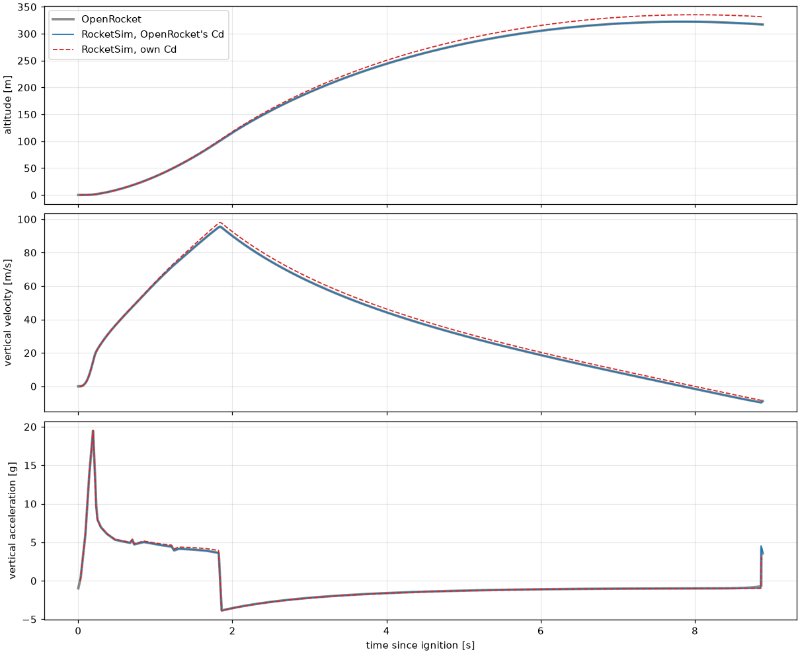
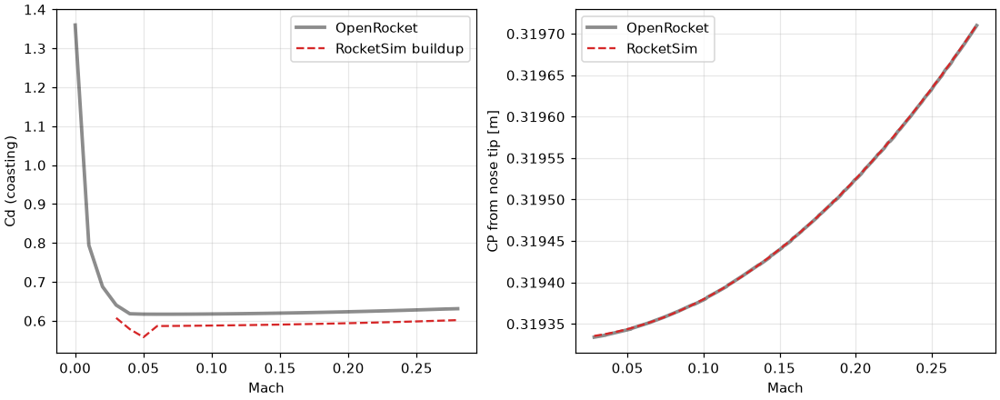

# Validation report

RocketSim is compared with **OpenRocket 23.09** (the standard hobby simulator) and **RocketPy** on OpenRocket's bundled example, *A simple model rocket* by Sampo Niskanen, on an Estes C6-7. The rocket is rebuilt in [`configs/simple_rocket.yaml`](../configs/simple_rocket.yaml) from the masses and positions OpenRocket reports.

OpenRocket's own engine produced the reference data, driven by [`validation/openrocket_export.py`](../validation/openrocket_export.py) with a 5 ms step and no turbulence; it's stored in `reference/openrocket/`. To reproduce the numbers below:

```bash
python validation/compare.py
```

The checks also run in `tests/test_validation.py`.

## Result against the acceptance targets

| Target (PLAN.md) | Required | Achieved |
|---|---|---|
| Apogee vs OpenRocket, with OpenRocket's Cd | within 5 % | **−0.01 %** |
| Apogee vs OpenRocket, with our own aerodynamics | within 10 % | **+4.03 %** |
| CP vs OpenRocket | within 2 % | **matches to 4 significant digits** |
| Every gap over 2 % explained | yes | see below |

## Layer 1: dynamics only (using OpenRocket's Cd table)

This separates errors in the equations of motion from errors in the aerodynamics.

| Quantity | RocketSim | OpenRocket | Difference |
|---|---|---|---|
| Apogee | 322.33 m | 322.36 m | −0.01 % |
| Time of apogee (from ignition) | 7.840 s | 7.842 s | −0.02 % |
| Max velocity | 95.43 m/s | 95.46 m/s | −0.02 % |
| Max acceleration | 19.52 g | 19.46 g | +0.28 % |
| Descent rate | 4.138 m/s | 4.136 m/s | +0.05 % |
| Drift, 2 m/s constant wind | 111.3 m | 113.5 m | −1.89 % |

**RocketPy**, same rocket and Cd table, to apogee: 322.75 m, 7.853 s, 95.47 m/s. RocketSim is within 0.13 % of it.



## Layer 2: aerodynamics and mass, compared directly



**CP:** matches at every Mach compared (for example 0.3195 m at Mach 0.2 in both).

**Cd (coasting):** ours is about 5 % low.

| Mach | RocketSim | OpenRocket |
|---|---|---|
| 0.05 | 0.558 | 0.617 |
| 0.10 | 0.588 | 0.618 |
| 0.15 | 0.590 | 0.620 |
| 0.20 | 0.594 | 0.623 |
| 0.25 | 0.599 | 0.628 |

**Mass properties:**

| Quantity | RocketSim | OpenRocket | Difference |
|---|---|---|---|
| Launch mass | 71.27 g | 71.26 g | +0.02 % |
| Launch CG | 0.2573 m | 0.2598 m | −0.98 % |
| Burnout CG | 0.2366 m | 0.2396 m | −1.25 % |
| Launch pitch inertia | 1.18e-3 kg·m² | 1.12e-3 kg·m² | +6.03 % |
| Burnout pitch inertia | 1.01e-3 kg·m² | 0.95e-3 kg·m² | +6.32 % |

## Layer 3: full simulator (own aerodynamics and dynamics)

| Quantity | RocketSim | OpenRocket | Difference |
|---|---|---|---|
| Apogee | 335.35 m | 322.36 m | +4.03 % |
| Time of apogee | 7.996 s | 7.842 s | +1.96 % |
| Max velocity | 97.95 m/s | 95.46 m/s | +2.62 % |
| Max acceleration | 19.53 g | 19.46 g | +0.33 % |
| Descent rate | 4.138 m/s | 4.136 m/s | +0.05 % |
| Drift, 2 m/s constant wind | 116.6 m | 113.5 m | +2.71 % |

## Every gap over 2 %, explained

**1. Cd about 5 % low, which causes apogee +4.0 % and max velocity +2.6 %.** OpenRocket's own drag breakdown at Mach 0.2 (`reference/openrocket/drag_breakdown.json`) shows why:

| Part of Cd | OpenRocket | RocketSim |
|---|---|---|
| Base | 0.125 | 0.125 |
| Launch lug | 0.039 | not modelled |
| Other pressure (fins, nose) | 0.028 | 0.027 |
| Friction | 0.432 | 0.442 |
| **Total** | **0.623** | **0.594** |

The missing launch lug is the cause, partly offset by slightly higher friction. Layer 1 confirms this is aerodynamic, not dynamic: with OpenRocket's Cd the gap vanishes.

Lug drag was deliberately not added. Niskanen's eq. 3.95 evaluated by hand gives about 0.067, not the 0.039 OpenRocket's code reports, so the thesis formula and the software disagree. A real rocket's lug or rail buttons add a few percent of Cd that this model omits, so its apogee will read a little high.

**2. Drift +2.7 %.** This follows from item 1: a higher apogee means a longer descent in the wind. With OpenRocket's Cd the gap is −1.89 %.

**3. Pitch inertia +6 %.** RocketSim treats most small parts as point masses and the nose as a thin shell; OpenRocket uses each part's real shape, including the nose shoulder. Moving the nose's CG about 6 mm forward accounts for about half of the gap by hand estimate. The remaining half wasn't traced to a specific part. Inertia only sets how fast the rocket rotates, so it barely affects these near-vertical flights; the wind case's −1.89 % drift is the evidence.

## What this doesn't prove

- **One rocket:** subsonic (Mach 0.28), small, near vertical. Other designs may differ more.
- **Simulators against each other:** agreeing with OpenRocket shows consistency with an accepted tool, not that either matches reality.
- **Real flight:** PLAN's stretch goal, comparing with a real flight log, needs a flight from you (an altimeter or your own ESP32 data).
- **Not compared:** Monte Carlo statistics, and attitude under strong crosswind.
